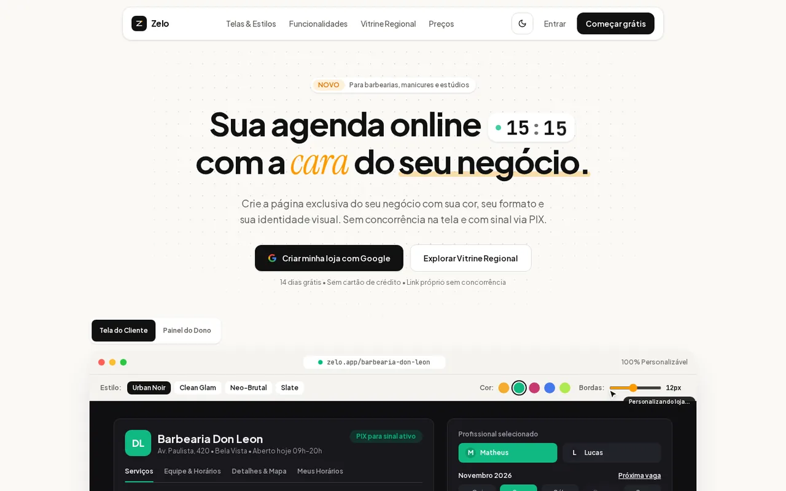
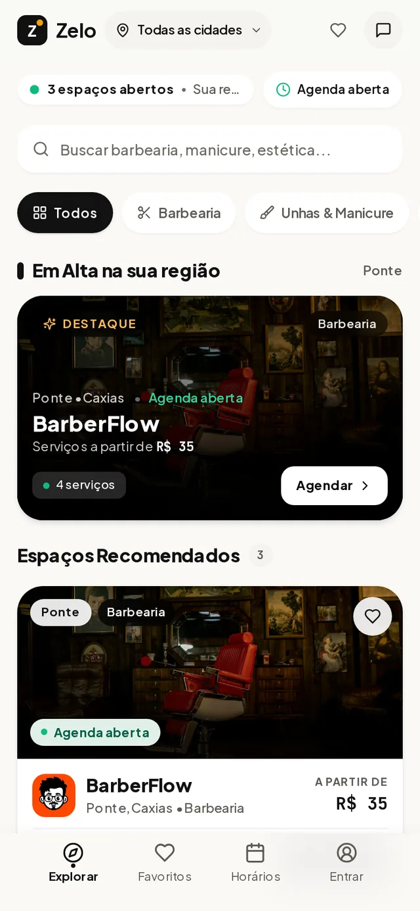
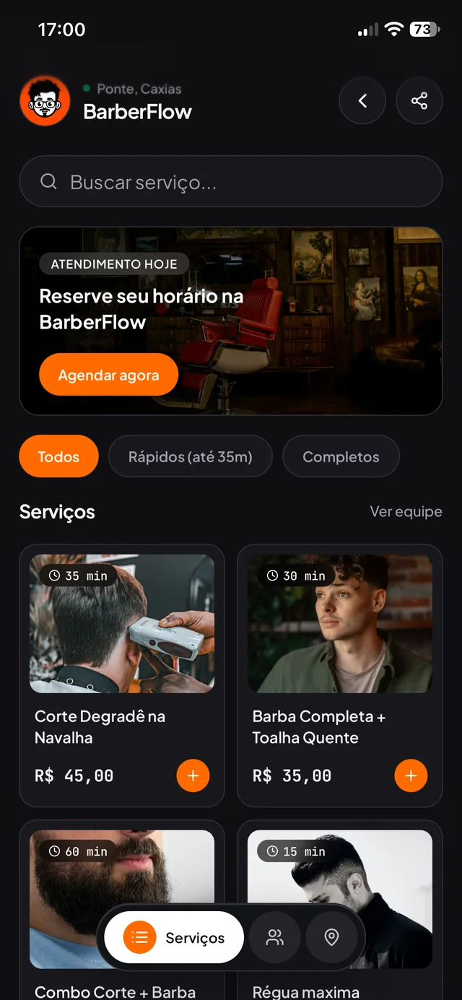
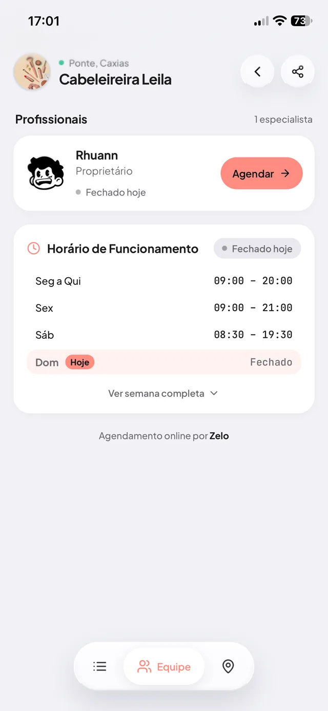
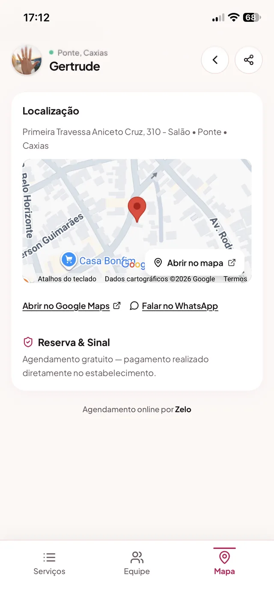

<div align="center">
  
  <h1>Zelo</h1>
  <p>
    <strong>SaaS multi-tenant white-label de agendamento e gestão para barbearias e estúdios de beleza.</strong>
  </p>
  <p>
    <a href="https://zelo-app.rhuu.workers.dev">Demo ao Vivo</a>
    &nbsp;·&nbsp;
    <a href="https://zelo-app.rhuu.workers.dev/explorar">Vitrine Regional (/explorar)</a>
  </p>

  <p>
    
    
    
    
    
    
    
  </p>
</div>

---

## Visão Geral

O **Zelo** permite que barbearias e estúdios publiquem sua própria loja de agendamento em segundos (`/[slug]`), com identidade visual personalizável, Vitrine Regional geolocalizada (`/explorar`), PWA instalável por estabelecimento e painel operacional mobile-first (`/painel`).

### Capturas de Tela

#### Landing Page (Desktop)
<p align="center">
  
</p>

#### Vitrine Regional & Lojas White-Label (Mobile)

<table>
  <tr>
    <td align="center" width="25%">
      
      <br />
      <sub><strong>Vitrine Regional</strong> (<code>/explorar</code>)</sub>
    </td>
    <td align="center" width="25%">
      
      <br />
      <sub><strong>Tema Urban</strong> — Serviços</sub>
    </td>
    <td align="center" width="25%">
      
      <br />
      <sub><strong>Tema Glass</strong> — Equipe</sub>
    </td>
    <td align="center" width="25%">
      
      <br />
      <sub><strong>Tema Glam</strong> — Mapa</sub>
    </td>
  </tr>
</table>

---

## Principais Funcionalidades

- **Vitrine Regional (`/explorar`)**: descoberta de estabelecimentos por cidade e bairro com mapa interativo (`Leaflet`) e busca rápida.
- **Loja Pública White-Label (`/[slug]`)**: página de agendamento mobile-first (`360px+`) com motor único de temas via CSS Tokens, suporte a modo claro/escuro e `manifest.webmanifest` dinâmico para instalação como PWA próprio da loja.
- **Agendamento Blindado**: reserva online com proteção anti-bot (`Cloudflare Turnstile`), trava atômica contra conflito de horários no PostgreSQL (`EXCLUDE USING gist`), reagendamento/cancelamento por token e chave Pix por profissional.
- **Painel do Lojista (`/painel`)**: agenda interativa (`Schedule-X`), encaixe manual no balcão, catálogo de serviços com imagens WebP comprimidas no cliente, gestão de equipe com convites seguros e metas semanais.
- **Notificações Web Push (PWA)**: lembretes e alertas em tempo real via VAPID + Service Worker (`public/sw.js`) com fallback offline (`public/offline.html`).
- **Assinaturas Recorrentes**: integração com webhooks do Asaas com validação segura e controle de idempotência.

---

## Stack Tecnológica

| Camada | Tecnologia | Versão |
| :--- | :--- | :--- |
| **Framework** | Next.js (App Router + Turbopack) | `15.3.2` |
| **UI & Linguagem** | React & TypeScript | `19.1.0` / `5.8.3` |
| **Estilização** | Tailwind CSS + CSS Design Tokens | `4.1.6` |
| **Banco & Auth** | Supabase (PostgreSQL, Auth Google, Storage, RLS) | `2.49.4` (`@supabase/ssr 0.6.1`) |
| **Agenda no Painel** | Schedule-X (`@schedule-x/react`, `calendar`, `events-service`) | `4.1.0` / `4.9.1` |
| **Mapas & Ícones** | Leaflet & Lucide React | `1.9.4` / `0.511.0` |
| **Validação & Push** | Zod & `web-push` (VAPID) | `3.24.4` / `4.0.0` |
| **Edge Deploy** | OpenNext Cloudflare & Wrangler | `1.20.17` / `4.162.0` |
| **Testes** | Vitest & Playwright | `3.1.3` / `1.65.1` |

---

## Arquitetura

- **Multi-Tenant Estrito**: todas as tabelas de domínio são isoladas por `loja_id` com **Row Level Security (RLS)** ativo no PostgreSQL. Fluxos públicos de consulta de disponibilidade e reserva utilizam funções RPC `SECURITY DEFINER`, evitando exposição direta da tabela de agendamentos.
- **Motor Único de Temas**: um único layout base alimentado por CSS Tokens dinâmicos (`Urban`, `Glass`, `Glam`, entre outros), mantendo o bundle da loja pública leve e sem dependências pesadas.
- **PWA & Edge-First**: build compilado para **Cloudflare Workers** via `@opennextjs/cloudflare`, combinado a um Service Worker leve com fallback offline e manifest dinâmico por loja (`src/app/[slug]/manifest.webmanifest/route.ts`).

---

## Setup Local

### Pré-requisitos

- **Node.js** `22+` e **npm**
- **Docker** (para rodar o Supabase local)

### Passo a passo

1. **Instale as dependências e configure as variáveis de ambiente:**
   ```bash
   cp .env.example .env.local
   npm install
   ```

2. **Suba o Supabase local (PostgreSQL, Auth, Storage e migrations):**
   ```bash
   npx supabase start
   ```

3. **Inicie o servidor de desenvolvimento:**
   ```bash
   npm run dev
   ```
   Acesse [http://localhost:3000](http://localhost:3000).

### Scripts Disponíveis

| Comando | Descrição |
| :--- | :--- |
| `npm run dev` | Inicia o servidor Next.js em modo desenvolvimento (`--turbopack`) |
| `npm run build` | Gera o build de produção do Next.js |
| `npm run lint` | Executa a verificação de lint (`next lint`) |
| `npm test` | Executa a suíte de testes unitários e de integração (`vitest run --no-file-parallelism`) |
| `npm run test:e2e` | Executa os testes end-to-end com Playwright (`playwright test`) |
| `npm run preview` | Gera o build OpenNext e testa localmente no runtime Cloudflare |
| `npm run deploy` | Empacota e publica a aplicação na Cloudflare Workers (`opennextjs-cloudflare deploy`) |

---

## Licença

Distribuído sob a licença **PolyForm Noncommercial 1.0.0**. Consulte o arquivo [LICENSE](LICENSE) para mais detalhes.
